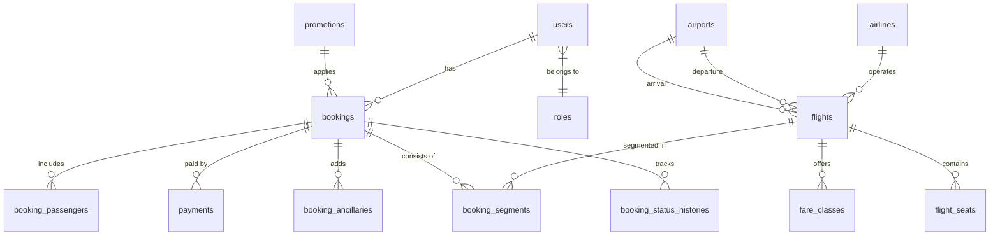
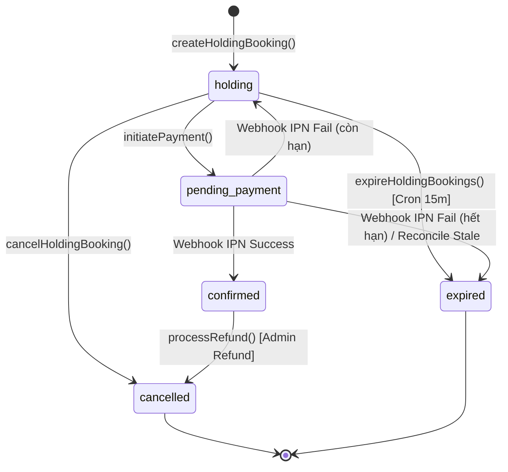
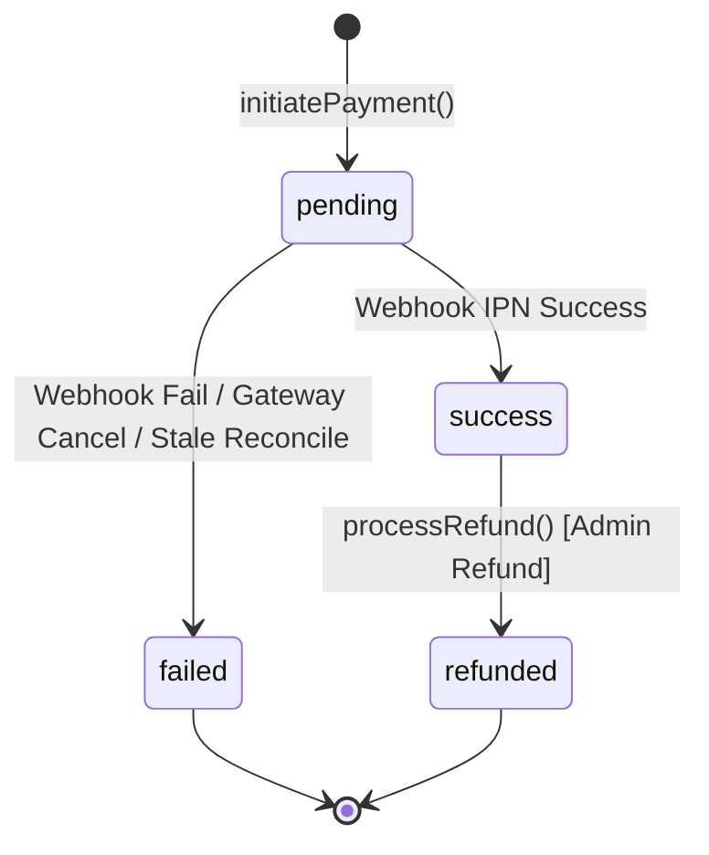

# TÀI LIỆU NGỮ CẢNH DỰ ÁN SERENE FLIGHTWAYS (PROJECT CONTEXT)

> **Dành cho**: Đội ngũ Kỹ thuật & Senior Fullstack Engineer  
> **Thời điểm lập**: 23/10/2026  
> **Phiên bản tài liệu**: 1.0.0  
> **Nguyên tắc**: Khảo sát hiện trạng thực tế dựa trên mã nguồn và cấu hình; tuyệt đối không suy diễn, không can thiệp CSDL/mã nguồn khi chưa phê duyệt.

---

## 1. TỔNG QUAN & CÁCH CHẠY LOCAL

### 1.1. Tổng quan dự án
Serene Flightways là hệ thống đặt vé máy bay trực tuyến phục vụ người dùng tìm kiếm chuyến bay, giữ chỗ 15 phút, thanh toán trực tuyến qua cổng VNPay/payOS (VietQR) và nhận vé điện tử PDF qua email. Hệ thống hỗ trợ phân quyền 3 cấp (Customer, Staff, Admin) với kiến trúc Backend Modular Monolith trên Node.js/Express và Frontend Single Page Application (SPA) trên React 19/Vite.

### 1.2. Cấu trúc cây thư mục (2-3 cấp)
Mô hình dự án tổ chức theo dạng Monorepo tích hợp:
```text
├── application/           # Composition Root, DI Container (buildContainer.js), App runtime (createApp.js)
├── config/                # Cấu hình CSDL Sequelize (config.js), Runtime validation (runtimeValidation.js)
├── controllers/           # Compatibility adapters cũ (chuyển tiếp tới các Canonical Modules)
├── designs/               # Bản vẽ UI/UX gốc từ Google Stitch
├── docs/                  # Báo cáo đồ án, tài liệu QA, kiểm thử nghiệp vụ
│   ├── qa/                # Báo cáo kiểm thử luồng nghiệp vụ & browser smoke test
│   └── PROJECT_CONTEXT.md # [Tài liệu này]
├── frontend/              # Ứng dụng Frontend React 19 + Vite 7 + React Router 7
│   ├── src/
│   │   ├── app/           # Router, AuthProvider, Route guards (AdminRoute, StaffOrAdminRoute)
│   │   ├── components/    # AppHeader, AppFooter, UI primitives, Pagination, StatusBadge
│   │   ├── features/      # Các phân hệ UI: flights, bookings, admin, auth, profile, roles, users...
│   │   ├── lib/           # apiClient (Fetch wrapper + refresh token retry), socket, validation
│   │   └── styles/        # CSS tokens, design system, global.css
│   └── package.json       # Dependencies và scripts frontend
├── infrastructure/        # Adapter kỹ thuật: Email (Resend), Realtime (Socket.IO), Background Jobs
├── jobs/                  # Cron jobs (expireBookings.job.js - quét hết hạn giữ chỗ và đối soát)
├── middlewares/           # auth.middleware, rbac.middleware, validate.middleware, optionalAuth
├── migrations/            # 19 migration Sequelize (khởi tạo schema, bảng segments, seat map, ancillaries...)
├── models/                # 21 Sequelize Models (User, Flight, Booking, Payment, Ancillaries, Seats...)
├── modules/               # 13 Canonical Modules (Kiến trúc Modular Monolith)
│   ├── airline/           # Quản lý hãng bay, logo upload, thống kê
│   ├── airport/           # Quản lý sân bay, gợi ý autocomplete
│   ├── ancillaries/       # [MỚI] Dịch vụ bổ trợ (hành lý, suất ăn, bảo hiểm)
│   ├── auth/              # Xác thực JWT, Refresh token, Quên/đổi mật khẩu
│   ├── booking/           # Đặt vé, giữ chỗ, nhiều chặng, hủy vé, tra cứu PNR
│   ├── fare-class/        # Quản lý hạng vé & hạn mức ghế (quota)
│   ├── flight/            # Tìm kiếm chuyến bay, bộ lọc, cập nhật trạng thái flight
│   ├── notification/      # [MỚI] Outbox pattern, thông báo người dùng
│   ├── payment/           # VNPay Sandbox, payOS VietQR adapter, Webhook, Doanh thu, Hoàn tiền
│   ├── promotion/         # Mã khuyến mãi, giảm giá percent/amount
│   ├── role/              # Phân quyền vai trò RBAC
│   ├── seat-selection/    # [MỚI] Sơ đồ ghế máy bay (Seat Map), chọn vị trí ghế
│   ├── ticket/            # Xuất vé điện tử PDF (PDFKit)
│   └── user/              # Quản lý tài khoản người dùng
├── routes/                # Route definitions & mapping tương thích
├── scripts/               # Scripts khởi động demo, seed dữ liệu an toàn, CI test runner
├── seeders/               # Database seeder (Roles, Users, Airlines, Airports, Flights, FareClasses)
├── services/              # Compatibility service layer (tương thích backward)
├── shared/                # HTTP filters, error handlers, guards
├── sockets/               # Cấu hình Socket.IO server (cảnh báo ghế, trạng thái chuyến bay)
├── tests/                 # >90 test files bao phủ backend unit/integration tests
├── docker-compose.yml     # Khởi chạy cụm MySQL 8.0 + API + Bootstrap agent
├── Dockerfile             # Đóng gói Node.js 20 backend image
├── package.json           # Scripts & dependencies backend
├── server.js              # Điểm vào chính của Backend Server
└── start-project.bat      # Script khởi động tự động local bằng Windows Batch
```

### 1.3. Danh sách npm scripts và cách khởi động Local

#### Các script trong `package.json` (Root Backend):
- `npm start`: Khởi động backend production qua `node server.js`.
- `npm run dev`: Chạy backend ở chế độ phát triển với `nodemon server.js` (tự reload khi đổi file).
- `npm test`: Chạy toàn bộ unit/integration tests backend bằng Node Test Runner (`node --test tests/*.test.js`).
- `npm run test:mysql-business`: Chạy bộ test tích hợp luồng nghiệp vụ trên CSDL MySQL thật (`tests/mysqlBusinessIntegration.test.js`).
- `npm run test:seed:demo`: Kiểm thử tính an toàn và điều kiện tiên quyết của bộ seed demo.
- `npm run seed:demo:docker`: Nạp dữ liệu mẫu vào môi trường container Docker (`scripts/seed-demo-docker.js`).
- `npm run demo:setup`: Chuẩn bị môi trường demo, kiểm tra kết nối CSDL và migration.
- `npm run demo:up`: Khởi động toàn diện môi trường demo Docker có kiểm soát (`scripts/demo-up.js`).
- `npm run smoke:payos-demo`: Chạy kịch bản kiểm thử giả lập thanh toán payOS VietQR.

#### Các script trong `frontend/package.json`:
- `npm run dev`: Khởi động Vite dev server tại `http://localhost:5173`.
- `npm run build`: Đóng gói ứng dụng React thành static files trong `frontend/dist`.
- `npm run preview`: Chạy thử bản build production trên Vite.
- `npm test`: Chạy unit test frontend bằng Vitest (`vitest`).

#### Cách khởi động hệ thống trên máy tính cá nhân (Local):
- **Cách 1: Khởi động tự động qua Docker (`start-project.bat`)**:
  Yêu cầu Docker Desktop đang chạy. Chạy script `start-project.bat` sẽ tự động:
  1. `docker compose up -d` kích hoạt container `db` (MySQL 8.0 trên cổng `3307`) và container `api` (cổng `5000`).
  2. Chờ API healthy và chạy `setup-demo-env.js` nạp tài khoản mẫu.
  3. Mở cửa sổ cmd mới chạy `npm run dev` cho Frontend tại `http://localhost:5173`.
- **Cách 2: Khởi động thủ công không dùng Docker (Local Node + Local MySQL/WAMP)**:
  1. Tạo CSDL MySQL local: `airline_booking_db` trên cổng `3306`.
  2. Tạo file `.env` từ `.env.example`, điền thông tin kết nối DB local (`DB_HOST=127.0.0.1`, `DB_PORT=3306`, `DB_USER`, `DB_PASS`).
  3. Chạy migration: `npx sequelize-cli db:migrate`.
  4. Chạy backend: `npm run dev` (API lắng nghe tại `http://localhost:5000/api/v1`).
  5. Chạy frontend: chuyển vào thư mục `frontend/`, chạy `npm run dev` (mở tại `http://localhost:5173`).

### 1.4. Danh mục Biến môi trường (Environment Variables)

> [!IMPORTANT]
> Tuyệt đối không ghi giá trị bí mật vào tài liệu. Dưới đây là danh sách TÊN biến và mục đích sử dụng được đọc từ [.env.example](file:///c:/wamp64/www/Web-Specialization-Web-Project-for-Airline-Ticket-Booking-Service-/.env.example) và [docker-compose.yml](file:///c:/wamp64/www/Web-Specialization-Web-Project-for-Airline-Ticket-Booking-Service-/docker-compose.yml).

#### Backend Environment Variables:
| Tên biến | Bắt buộc / Mặc định | Mục đích & Ý nghĩa |
| :--- | :---: | :--- |
| `PORT` | Mặc định `5000` | Cổng HTTP lắng nghe của Express backend |
| `NODE_ENV` | Mặc định `development` | Môi trường thực thi (`development`, `test`, `production`) |
| `CLIENT_URL` | Mặc định `http://localhost:5173` | URL Frontend cho cấu hình CORS |
| `DB_HOST` | Bắt buộc | Địa chỉ máy chủ CSDL MySQL / TiDB |
| `DB_PORT` | Mặc định `3306` (TiDB `4000`) | Cổng kết nối CSDL |
| `DB_NAME` | Bắt buộc | Tên cơ sở dữ liệu |
| `DB_USER` | Bắt buộc | Tài khoản truy cập CSDL |
| `DB_PASS` | Bắt buộc | Mật khẩu truy cập CSDL |
| `DB_SSL` | Mặc định `false` | Bật/tắt kết nối SSL/TLS (bắt buộc `true` với TiDB Cloud) |
| `DB_SSL_CA` | Tùy chọn (khi SSL=true) | Chuỗi chứng chỉ CA định dạng PEM |
| `JWT_SECRET` | Bắt buộc | Khóa bí mật ký Access Token (JWT) |
| `JWT_EXPIRES_IN` | Mặc định `15m` | Thời hạn sống của Access Token |
| `JWT_REFRESH_SECRET` | Bắt buộc | Khóa bí mật ký Refresh Token (khác `JWT_SECRET`) |
| `JWT_REFRESH_EXPIRES_IN` | Mặc định `7d` | Thời hạn sống của Refresh Token |
| `PASSWORD_RESET_URL` | Mặc định `.../reset-password` | Đường dẫn frontend nhận token đặt lại mật khẩu |
| `PASSWORD_RESET_EXPIRES_MINUTES` | Mặc định `30` | Thời hạn hiệu lực của link reset password |
| `HOLDING_TIME_MINUTES` | Mặc định `15` | Số phút giữ chỗ tạm thời cho đơn hàng (`holding`) |
| `PAYMENT_PENDING_GRACE_MINUTES` | Mặc định `5` | Thời gian ân hạn chờ callback trước khi đối soát |
| `ENABLE_PENDING_RECONCILIATION` | Mặc định `false` | Bật/tắt đối soát tự động đơn pending bị treo |
| `SEAT_WARNING_THRESHOLD` | Mặc định `5` | Ngưỡng số ghế còn lại để bắn cảnh báo WebSocket |
| `VNP_TMN_CODE` | Bắt buộc (khi dùng VNPay) | Mã Terminal ID do VNPay cấp |
| `VNP_HASH_SECRET` | Bắt buộc (khi dùng VNPay) | Chuỗi bí mật tạo chữ ký checksum HMAC-SHA512 |
| `VNP_URL` | Bắt buộc (khi dùng VNPay) | URL cổng thanh toán VNPay Sandbox |
| `VNP_RETURN_URL` | Mặc định URL frontend | URL trình duyệt chuyển hướng về sau thanh toán |
| `PAYMENT_RETURN_URL_ALLOWLIST`| Mặc định `http://localhost:3000` | Danh sách whitelist các origin return URL hợp lệ |
| `PAYOS_MODE` | Mặc định `disabled` | Chế độ payOS: `disabled`, `demo` (mô phỏng), `live` (thật) |
| `PAYOS_DEMO_SECRET` | Bắt buộc (khi mode=demo) | Khóa bí mật ký webhook giả lập trong môi trường học thuật |
| `PAYOS_CLIENT_ID` | Bắt buộc (khi mode=live) | Client ID do payOS cấp |
| `PAYOS_API_KEY` | Bắt buộc (khi mode=live) | API Key do payOS cấp |
| `PAYOS_CHECKSUM_KEY` | Bắt buộc (khi mode=live) | Khóa kiểm tra checksum do payOS cấp |
| `PAYOS_BASE_URL` | Mặc định `https://api-merchant...` | Endpoint API của payOS |
| `PAYOS_RETURN_URL` | Bắt buộc | URL return của payOS |
| `PAYOS_CANCEL_URL` | Bắt buộc | URL cancel của payOS |
| `PAYOS_WEBHOOK_URL` | Bắt buộc | Webhook tiếp nhận thanh toán từ payOS |
| `DISABLE_CRON` | Mặc định `false` | Tắt cron job (phục vụ chạy test độc lập) |
| `RESEND_API_KEY` | Bắt buộc (nếu gửi mail thật) | Khóa API gửi email dịch vụ Resend |
| `EMAIL_FROM` | Mặc định email Resend test | Tên và email người gửi thư xác nhận đặt chỗ |
| `SEED_ADMIN_EMAIL` | Tùy chọn seed | Email khởi tạo tài khoản quản trị |
| `SEED_ADMIN_PASSWORD` | Tùy chọn seed | Mật khẩu khởi tạo tài khoản quản trị |
| `SEED_USER_PASSWORD` | Tùy chọn seed | Mật khẩu chung cho các tài khoản demo sinh tự động |

#### Frontend Environment Variables:
| Tên biến | Bắt buộc / Mặc định | Mục đích & Ý nghĩa |
| :--- | :---: | :--- |
| `VITE_API_BASE_URL` | Mặc định `/api/v1` | Base URL để frontend gọi API backend |

---

## 2. KIẾN TRÚC BACKEND & BẢN ĐỒ MODULE/ENDPOINT

### 2.1. Điểm vào & Thứ tự Middleware
- **Entry point**: [server.js](file:///c:/wamp64/www/Web-Specialization-Web-Project-for-Airline-Ticket-Booking-Service-/server.js) kiểm tra cấu hình runtime (`validateRuntimeConfiguration`), khởi tạo Socket.IO (`initSocket`), kết nối CSDL Sequelize, khởi chạy cron job (`initExpireBookingsJob`) và wrap bằng `createRuntime`.
- **Express App**: [application/createApp.js](file:///c:/wamp64/www/Web-Specialization-Web-Project-for-Airline-Ticket-Booking-Service-/application/createApp.js) nạp middleware theo thứ tự nghiêm ngặt:
  1. `helmet()`: Bảo vệ HTTP headers an toàn.
  2. `cors({ origin: CLIENT_URL, credentials: true })`: Kiểm soát truy cập nguồn gốc.
  3. `morgan('dev')`: Ghi log request (tắt khi `NODE_ENV=test`).
  4. `express.json({ limit: '10mb' })` & `express.urlencoded({ extended: true, limit: '10mb' })`: Xử lý payload JSON và form body.
  5. `express.static('/public')`: Phục vụ file tĩnh.
  6. Router chính được gắn tiền tố: `/api/v1` qua [application/registerModules.js](file:///c:/wamp64/www/Web-Specialization-Web-Project-for-Airline-Ticket-Booking-Service-/application/registerModules.js).
  7. Route 404 handler chuẩn hóa định dạng JSON (`ApiResponse.error`).
  8. Global error filter/adapter: bắt lỗi validation, Sequelize errors, 500.

### 2.2. Bản đồ 13 Modules và Danh mục Endpoint đầy đủ

Tất cả các route dưới đây đều có tiền tố chung là `/api/v1`.

| Module | Method | Path | Quyền truy cập | Controller / Service xử lý | Validator áp dụng |
| :--- | :---: | :--- | :--- | :--- | :--- |
| **Auth** | `POST` | `/auth/register` | Public | `AuthController.register` | `registerValidator` |
| | `POST` | `/auth/login` | Public | `AuthController.login` | `loginValidator` |
| | `POST` | `/auth/refresh-token` | Public | `AuthController.refreshToken` | `refreshTokenValidator` |
| | `POST` | `/auth/forgot-password` | Public | `AuthController.forgotPassword` | `forgotPasswordValidator` |
| | `POST` | `/auth/reset-password` | Public | `AuthController.resetPassword` | `resetPasswordValidator` |
| | `POST` | `/auth/logout` | Authenticated | `AuthController.logout` | None |
| | `GET` | `/auth/me` | Authenticated | `AuthController.getMe` | None |
| | `PUT` | `/auth/me` | Authenticated | `AuthController.updateProfile` | `updateProfileValidator` |
| | `PUT` | `/auth/change-password` | Authenticated | `AuthController.changePassword` | `changePasswordValidator` |
| **Users** | `GET` | `/users` | Admin | `UserController.getAllUsers` | `listUserValidator` |
| | `GET` | `/users/:id` | Admin | `UserController.getUserById` | `userIdValidator` |
| | `PATCH` | `/users/:id/status` | Admin | `UserController.updateUserStatus` | `userStatusValidator` |
| | `PATCH` | `/users/:id/role` | Admin | `UserController.updateUserRole` | `userRoleValidator` |
| | `DELETE` | `/users/:id` | Admin | `UserController.deleteUser` | `userIdValidator` |
| **Roles** | `GET` | `/roles` | Admin | `RoleController.getAllRoles` | None |
| | `GET` | `/roles/:id` | Admin | `RoleController.getRoleById` | `roleIdValidator` |
| | `POST` | `/roles` | Admin | `RoleController.createRole` | `createRoleValidator` |
| | `PUT` | `/roles/:id` | Admin | `RoleController.updateRole` | `updateRoleValidator` |
| | `DELETE` | `/roles/:id` | Admin | `RoleController.deleteRole` | `roleIdValidator` |
| **Airlines**| `GET` | `/airlines/statistics` | Admin | `AirlineController.getStatistics` | None |
| | `POST` | `/airlines/upload-logo` | Admin | `AirlineController.uploadLogo` | None |
| | `GET` | `/airlines` | Public | `AirlineController.getAll` | `listAirlineValidator` |
| | `GET` | `/airlines/:id` | Public | `AirlineController.getById` | `airlineIdValidator` |
| | `POST` | `/airlines` | Admin | `AirlineController.create` | `createAirlineValidator` |
| | `PUT` | `/airlines/:id` | Admin | `AirlineController.update` | `updateAirlineValidator` |
| | `DELETE` | `/airlines/:id` | Admin | `AirlineController.delete` | `airlineIdValidator` |
| **Airports**| `GET` | `/airports` | Public | `AirportController.getAll` | None |
| | `GET` | `/airports/:id` | Public | `AirportController.getById` | None |
| | `POST` | `/airports` | Admin | `AirportController.create` | None |
| | `PUT` | `/airports/:id` | Admin | `AirportController.update` | None |
| | `DELETE` | `/airports/:id` | Admin | `AirportController.delete` | None |
| **Flights** | `GET` | `/flights/search` | Public | `FlightController.searchFlights` | `searchFlightValidator` |
| | `GET` | `/flights/status/:id` | Public | `FlightController.getFlightStatus` | `flightStatusValidator` |
| | `PATCH` | `/flights/status/:id` | Admin | `FlightController.updateFlightStatus` | `updateFlightStatusValidator` |
| | `GET` | `/flights/:id` | Public | `FlightController.getFlightById` | None |
| | `GET` | `/flights` | Admin, Staff | `FlightController.getAllFlights` | `adminFlightListValidator` |
| | `POST` | `/flights` | Admin | `FlightController.createFlight` | `createFlightValidator` |
| | `PUT` | `/flights/:id` | Admin, Staff | `FlightController.updateFlight` | `updateFlightValidator` |
| | `PUT` | `/flights/:id/cancel`| Admin, Staff | `FlightController.cancelFlight` | `cancelFlightValidator` |
| | `DELETE` | `/flights/:id` | Admin | `FlightController.deleteFlight` | None |
| **FareClass**| `GET` | `/fare-classes/flight/:flightId` | Public | `FareClassController.getByFlightId` | `flightIdParamValidator` |
| | `GET` | `/fare-classes/:id` | Public | `FareClassController.getById` | `fareClassIdParamValidator` |
| | `POST` | `/fare-classes` | Admin, Staff | `FareClassController.create` | `createFareClassValidator` |
| | `PUT` | `/fare-classes/:id` | Admin, Staff | `FareClassController.update` | `updateFareClassValidator` |
| | `DELETE` | `/fare-classes/:id` | Admin | `FareClassController.delete` | `fareClassIdParamValidator` |
| **Bookings**| `POST` | `/bookings` | Optional Auth (Customer/Guest)| `BookingController.createBooking` | `createBookingValidator` |
| | `GET` | `/bookings/my-bookings` | Authenticated | `BookingController.getMyBookings` | `listBookingValidator` |
| | `GET` | `/bookings/lookup/:code` | Public (Guest PNR + Email) | `BookingController.lookupBooking` | `lookupBookingValidator` |
| | `GET` | `/bookings/admin/all` | Admin, Staff | `BookingController.getAllBookings` | `listBookingValidator` |
| | `GET` | `/bookings/:id/ticket`| Optional Auth (Owner/Guest email)| `TicketController.downloadTicket` | `downloadTicketValidator` |
| | `GET` | `/bookings/:id` | Optional Auth (Owner/Guest/Staff)| `BookingController.getBookingById`| `bookingAccessEmailValidator` |
| | `PUT` | `/bookings/:id/cancel`| Optional Auth (Owner/Guest) | `BookingController.cancelBooking` | `cancelBookingValidator` |
| **Payments**| `POST` | `/payments/initiate` | Optional Auth (Owner/Guest) | `PaymentController.initiatePayment`| `initiatePaymentValidator` |
| | `GET` | `/payments/vnpay/return`| Public (Browser redirect) | `PaymentController.vnpayReturn` | None |
| | `GET` | `/payments/vnpay/ipn` | Public (VNPay Server call) | `PaymentController.vnpayIpn` | None |
| | `GET` | `/payments/payos/return`| Public (Browser redirect) | `PaymentController.payosReturn` | None |
| | `POST` | `/payments/payos/webhook`| Public (payOS Server call) | `PaymentController.payosWebhook` | None |
| | `POST` | `/payments/payos/demo-webhook`| Public (Chỉ bật local demo)| `PaymentController.payosDemoWebhook`| None |
| | `GET` | `/payments/revenue` | Admin | `PaymentController.getRevenue` | `revenueValidator` |
| | `GET` | `/payments` | Admin | `PaymentController.getAllPayments` | `paymentListValidator` |
| | `GET` | `/payments/:id` | Admin | `PaymentController.getPaymentById`| `paymentIdValidator` |
| | `POST` | `/payments/bookings/:id/refund` | Admin | `PaymentController.refundBooking` | `refundValidator` |
| **Promotions**| `GET` | `/promotions` | Public | `PromotionController.getAll` | None |
| | `GET` | `/promotions/:id` | Public | `PromotionController.getById` | None |
| | `POST` | `/promotions` | Admin | `PromotionController.create` | None |
| | `PUT` | `/promotions/:id` | Admin | `PromotionController.update` | None |
| | `DELETE` | `/promotions/:id` | Admin | `PromotionController.delete` | None |
| **Seat Map**| `GET` | `/seat-selection/templates` | Admin | `SeatSelectionController.listTemplates` | None |
| | `POST` | `/seat-selection/templates` | Admin | `SeatSelectionController.createTemplate` | None |
| | `PUT` | `/seat-selection/templates/:id` | Admin | `SeatSelectionController.updateTemplate` | None |
| | `DELETE` | `/seat-selection/templates/:id` | Admin | `SeatSelectionController.deleteTemplate` | None |
| | `PUT` | `/seat-selection/flights/:flightId/map` | Admin | `SeatSelectionController.assignFlight` | None |
| | `GET` | `/seat-selection/flights/:flightId/map` | Public | `SeatSelectionController.getFlightMap` | None |
| **Ancillaries**| `GET` | `/ancillaries` | Public | `AncillariesController.listOffers` | None |
| | `GET` | `/ancillaries/admin/services` | Admin | `AncillariesController.listServices` | None |
| | `POST` | `/ancillaries/admin/services` | Admin | `AncillariesController.createService` | None |
| | `PUT` | `/ancillaries/admin/services/:id` | Admin | `AncillariesController.updateService` | None |
| | `DELETE` | `/ancillaries/admin/services/:id` | Admin | `AncillariesController.deactivateService` | None |
| | `GET` | `/ancillaries/admin/offers` | Admin | `AncillariesController.listOffersAdmin` | None |
| | `POST` | `/ancillaries/admin/offers` | Admin | `AncillariesController.createOffer` | None |
| | `PUT` | `/ancillaries/admin/offers/:id` | Admin | `AncillariesController.updateOffer` | None |
| | `DELETE` | `/ancillaries/admin/offers/:id` | Admin | `AncillariesController.deactivateOffer` | None |
| **Notifications**| `GET` | `/notifications` | Authenticated | `NotificationController.list` | `listNotificationsValidator` |
| | `GET` | `/notifications/unread-count` | Authenticated | `NotificationController.unreadCount` | None |
| | `PATCH` | `/notifications/:id/read` | Authenticated | `NotificationController.markRead` | `notificationIdValidator` |

---

## 3. MÔ HÌNH DỮ LIỆU THỰC TẾ & SO SÁNH VỚI BÁO CÁO

### 3.1. So sánh tổng quan về Bảng dữ liệu
- **Báo cáo gốc (Chương 3)**: Định nghĩa **10 bảng chính** (`users`, `roles`, `airlines`, `airports`, `flights`, `fare_classes`, `bookings`, `booking_passengers`, `payments`, `promotions`).
- **Thực tế trong source code (21 Models Sequelize & 19 Migrations)**:
  Có đầy đủ 10 bảng gốc và được mở rộng thêm **11 bảng mới**:
  1. `booking_segments`: Lưu trữ các chặng của chuyến bay khứ hồi hoặc nhiều chặng.
  2. `booking_status_histories`: Lịch sử kiểm toán các lần đổi trạng thái booking.
  3. `flight_status_histories`: Lịch sử thay đổi giờ bay, hủy, trễ chuyến của chuyến bay.
  4. `seat_map_templates`: Mẫu cấu hình sơ đồ ghế máy bay.
  5. `flight_seat_maps`: Sơ đồ ghế thực tế gắn vào từng chuyến bay.
  6. `flight_seats`: Trạng thái và thông tin chi tiết từng ghế ngồi (hàng, cột, trạng thái đặt).
  7. `ancillary_services`: Danh mục các dịch vụ bổ trợ (hành lý, suất ăn, bảo hiểm).
  8. `ancillary_offers`: Các gói chào bán dịch vụ bổ trợ theo chặng và mức giá.
  9. `booking_ancillaries`: Snapshot lưu chi tiết dịch vụ bổ trợ hành khách đã mua.
  10. `notifications`: Danh sách thông báo gửi cho người dùng.
  11. `notification_outbox`: Bảng xử lý Transactional Outbox pattern cho thông báo.

### 3.2. Cấu trúc các bảng chính, Quan hệ & Index



#### Chi tiết các Index đáng chú ý trong CSDL:
- **`flights`**: `['departure_airport_id', 'arrival_airport_id', 'departure_time']` (phục vụ tìm kiếm chuyến bay nhanh chóng), `['airline_id']`, `['status']`.
- **`bookings`**: `['status', 'user_id']` (`bookings_status_user_idx`), `['booking_code']` (UNIQUE), `['flight_id']`, `['hold_expires_at']`.
  > [!WARNING]
  > Bảng `bookings` hiện có index riêng trên `hold_expires_at` và index kép trên `(status, user_id)`, nhưng **chưa có composite index trên `(status, hold_expires_at)`**. Khi số lượng đơn hàng lớn, cron job quét đơn hết hạn sẽ phải duyệt index và lọc thêm.
- **`payments`**: `['transaction_ref']` (UNIQUE), `['booking_id']`, `['idempotency_key']` (UNIQUE, chống tạo giao dịch trùng lặp).
- **`booking_segments`**: `['booking_id', 'leg_order']` (UNIQUE), `['flight_id']`.
- **`flight_seats`**: `['flight_seat_map_id', 'seat_number']` (UNIQUE), `['booking_id']`.

---

## 4. LUỒNG NGHIỆP VỤ CHÍNH & SƠ ĐỒ TRẠNG THÁI

### 4.1. Tìm kiếm chuyến bay (Flight Discovery)
- **Hàm xử lý**: `FlightService.searchFlights` ([modules/flight/flight.service.js](file:///c:/wamp64/www/Web-Specialization-Web-Project-for-Airline-Ticket-Booking-Service-/modules/flight/flight.service.js#L67-L92)).
- **Tham số**: `departure_airport_id`, `arrival_airport_id`, `departure_date`, `min_seats`, `airline_id`, `min_price`, `max_price`, `fare_class`, `departure_time_from`, `departure_time_to`, `sort_by`, `page`, `limit`.
- **Xử lý múi giờ**: Chuyển đổi ngày địa phương Việt Nam (`VN_OFFSET_MS = 7*60*60*1000`) để tính trọn vẹn khung 24h của ngày khởi hành.
- **Sắp xếp**: Hỗ trợ `price_low`, `price_high`, `departure_earliest`, `departure_latest`, `duration_shortest`.

### 4.2. Tạo Booking & Khóa giữ chỗ (Inventory Row-Lock)
- **Hàm xử lý**: `BookingService.createHoldingBooking` ([modules/booking/booking.service.js](file:///c:/wamp64/www/Web-Specialization-Web-Project-for-Airline-Ticket-Booking-Service-/modules/booking/booking.service.js#L61-L260)).
- **Quy trình Transaction & Khóa dòng**:
  1. Khóa chuyến bay bằng `SELECT ... FOR UPDATE` cho từng chặng trong hành trình.
  2. Kiểm tra `flight.available_seats >= passengerCount`.
  3. Kiểm tra hạn mức `fare_class.seat_quota` (nếu có cấu hình).
  4. Nếu có chọn ghế ngồi (`seat_selections`), kiểm tra trạng thái ghế trống và khóa ghế tạm thời.
  5. Nếu có dịch vụ bổ trợ (`ancillary_selections`), snapshot giá dịch vụ.
  6. Nếu có mã khuyến mãi (`promotion_code`), khóa dòng mã bằng `FOR UPDATE`, kiểm tra hạn dùng, kiểm tra `used_count < max_uses`, tính giảm giá (`percent` hoặc `amount`), tăng `used_count += 1`.
  7. Trừ trực tiếp `available_seats` của từng chuyến bay.
  8. Sinh mã PNR duy nhất (`BK` + 6 ký tự hex), gán `hold_expires_at = now + HOLDING_TIME_MINUTES` (15 phút).
  9. Tạo bản ghi `bookings` trạng thái `holding`, tạo `booking_passengers`, `booking_segments`, `booking_ancillaries`.
  10. Ghi log lịch sử `booking_status_histories`.
  11. Sau khi commit transaction, phát sự kiện WebSocket `flight_seats_updated` và `seat-warning`.

### 4.3. Khởi tạo & Xử lý Thanh toán (Payment Lifecycle & Webhooks)
- **Khởi tạo**: `PaymentService.initiatePayment` ([modules/payment/payment.service.js](file:///c:/wamp64/www/Web-Specialization-Web-Project-for-Airline-Ticket-Booking-Service-/modules/payment/payment.service.js#L327-L567)) chuyển booking sang trạng thái trung gian `pending_payment`, tạo bản ghi payment trạng thái `pending`.
- **VNPay Return URL**: `PaymentService.handleVnpayReturn` chỉ đối chiếu checksum hiển thị thông báo, **không bao giờ thay đổi CSDL**.
- **VNPay IPN (Webhook)**: `PaymentService.handleVnpayIpn` ([modules/payment/payment.service.js](file:///c:/wamp64/www/Web-Specialization-Web-Project-for-Airline-Ticket-Booking-Service-/modules/payment/payment.service.js#L616-L750)) thực hiện 6 bước:
  1. Xác thực chữ ký HMAC-SHA512 (`vnp_SecureHash`).
  2. Tìm kiếm Payment & Booking theo `vnp_TxnRef`.
  3. Kiểm tra Idempotency (nếu đã `success` thì trả `RspCode: 02` ngay).
  4. Kiểm tra trạng thái booking (phải là `pending_payment`).
  5. Đối chiếu số tiền thanh toán chính xác từng đồng VNĐ.
  6. Mở Transaction với row-lock:
     - Nếu thành công (`vnp_ResponseCode === '00'`): chuyển `payments.status = 'success'`, `bookings.status = 'confirmed'`, xác nhận ghế, xác nhận dịch vụ, xuất sự kiện outbox và gửi email xác nhận kèm vé điện tử PDF.
     - Nếu thất bại: đánh dấu `payments.status = 'failed'`. Nếu còn trong 15 phút giữ chỗ -> đưa booking trở lại `holding` để khách thanh toán lại; nếu đã quá hạn -> chuyển sang `expired`, hoàn trả ghế và hoàn lượt dùng khuyến mãi.
- **payOS VietQR (Demo mode)**: Adapter mô phỏng tạo mã VietQR có nội dung `DATVE <PNR>`. Webhook `POST /api/v1/payments/payos/demo-webhook` kiểm tra chữ ký HMAC và thực hiện quy trình cập nhật CSDL tương tự như VNPay.

### 4.4. Hết hạn giữ chỗ & Đối soát giao dịch treo
- **Hàm xử lý**: `BookingService.expireHoldingBookings` ([modules/booking/booking.service.js](file:///c:/wamp64/www/Web-Specialization-Web-Project-for-Airline-Ticket-Booking-Service-/modules/booking/booking.service.js#L438-L479)) chạy mỗi phút qua cron job.
  - **CHỈ QUÉT ĐƠN CÓ `status = 'holding'` VÀ `hold_expires_at <= now`**. Tuyệt đối không tự ý hủy đơn đang thanh toán `pending_payment`.
  - Mở transaction khóa dòng: chuyển booking sang `expired`, cộng trả lại `available_seats`, giải phóng ghế đã chọn, giảm `used_count` của mã khuyến mãi, phát WebSocket cập nhật ghế.
- **Đối soát giao dịch pending treo**: `BookingService.reconcileStalePendingPayments` (được kích hoạt nếu cấu hình `ENABLE_PENDING_RECONCILIATION=true`). Xử lý các đơn `pending_payment` bị bỏ rơi vượt quá thời gian giữ chỗ cộng thêm thời gian ân hạn (`PAYMENT_PENDING_GRACE_MINUTES`, mặc định 5 phút).

### 4.5. Hủy Booking & Hoàn tiền nội bộ (Refund)
- **Khách hàng tự hủy**: `BookingService.cancelHoldingBooking` ([modules/booking/booking.service.js](file:///c:/wamp64/www/Web-Specialization-Web-Project-for-Airline-Ticket-Booking-Service-/modules/booking/booking.service.js#L381-L431)) chỉ cho phép hủy khi đơn ở trạng thái `holding`. Hoàn trả ghế và hoàn mã khuyến mại.
- **Admin hoàn tiền**: `PaymentService.processRefund` ([modules/payment/payment.service.js](file:///c:/wamp64/www/Web-Specialization-Web-Project-for-Airline-Ticket-Booking-Service-/modules/payment/payment.service.js#L1017-L1093)):
  - Chỉ Admin được thực hiện trên đơn đã `confirmed` và có payment `success`.
  - Chuyển `payments.status = 'refunded'`, `bookings.status = 'cancelled'`, cộng trả lại ghế cho chuyến bay, giải phóng ghế ngồi và dịch vụ bổ trợ.
  - Đây là hoàn tiền nghiệp vụ nội bộ trong CSDL, **chưa gọi API hoàn tiền trực tiếp của cổng thanh toán**.

### 4.6. Sơ đồ trạng thái Booking và Payment





---

## 5. FRONTEND: ROUTE, COMPONENT & BẢNG TRẠNG THÁI GIAO DIỆN

### 5.1. Kiến trúc Frontend & Lớp gọi API
- **Framework**: React 19, React Router 7, Vite 7.
- **Quản lý phiên (Session & State)**: Quản lý tập trung trong [frontend/src/app/AuthProvider.jsx](file:///c:/wamp64/www/Web-Specialization-Web-Project-for-Airline-Ticket-Booking-Service-/frontend/src/app/AuthProvider.jsx). `accessToken` chỉ lưu trong bộ nhớ (`useRef`), Refresh Token lưu trong Cookie/Storage qua `tokenStorage.js`. Khi Access Token hết hạn (HTTP 401), [frontend/src/lib/apiClient.js](file:///c:/wamp64/www/Web-Specialization-Web-Project-for-Airline-Ticket-Booking-Service-/frontend/src/lib/apiClient.js) tự động kích hoạt `refreshAccessToken()`, xếp hàng các request đồng thời và retry tự động.
- **Route Guards**:
  - `PublicOnlyRoute`: Chỉ dành cho khách chưa đăng nhập (nếu đã đăng nhập sẽ tự chuyển hướng về `/profile` hoặc `/admin/users`).
  - `ProtectedRoute`: Bắt buộc đăng nhập.
  - `AdminRoute`: Bắt buộc vai trò `admin`.
  - `StaffOrAdminRoute`: Bắt buộc vai trò `staff` hoặc `admin`.

### 5.2. Bảng trạng thái chi tiết từng màn hình Frontend

| Đường dẫn (Route) | Tên Component chính | Trạng thái triển khai | Endpoint Backend kết nối | Đánh giá xử lý Loading / Empty / Error |
| :--- | :--- | :---: | :--- | :--- |
| `/` | `HomePage` | **Đã chạy hoàn chỉnh** | `GET /airports`, `GET /airlines`, `GET /flights/search` | Đầy đủ skeleton/help text, debounce tìm kiếm sân bay, báo lỗi vị trí GPS |
| `/flights/search` | `FlightResultsPage` | **Đã chạy hoàn chỉnh** | `GET /flights/search`, `GET /airports`, `GET /airlines` | Đầy đủ empty state khi không có chuyến bay, thanh lọc giá, lọc hãng, lọc giờ |
| `/bookings/new` | `BookingCreatePage` | **Đã chạy hoàn chỉnh** | `POST /bookings`, `GET /flights/:id`, `GET /seat-selection/...`, `GET /ancillaries` | Đầy đủ validate thông tin hành khách, chọn ghế sơ đồ, chọn hành lý/suất ăn |
| `/bookings/lookup` | `BookingLookupPage` | **Đã chạy hoàn chỉnh** | `GET /bookings/lookup/:code?guest_email=...` | Kiểm tra định dạng PNR, báo lỗi không tìm thấy đơn hoặc email không khớp |
| `/bookings/:id/payment`| `PaymentInitiatePage` | **Đã chạy hoàn chỉnh** | `POST /payments/initiate`, `GET /bookings/:id` | Đồng hồ đếm ngược 15 phút, QR payOS demo, nút giả lập thanh toán demo |
| `/payments/result` | `PaymentResultPage` | **Đã chạy hoàn chỉnh** | `GET /payments/vnpay/return`, `GET /payments/payos/return` | Hiển thị kết quả thanh toán, nút tải E-ticket PDF |
| `/bookings/my` | `MyBookingsPage` | **Đã chạy hoàn chỉnh** | `GET /bookings/my-bookings`, `PUT /bookings/:id/cancel` | Phân trang, lọc trạng thái, hủy đơn giữ chỗ, nút tải vé điện tử PDF |
| `/bookings/:id` | `BookingDetailPage` | **Đã chạy hoàn chỉnh** | `GET /bookings/:id`, `POST /payments/bookings/:id/refund` | Hiển thị chặng bay, hành khách, dịch vụ bổ trợ, nút hoàn tiền cho Admin |
| `/login` | `LoginPage` | **Đã chạy hoàn chỉnh** | `POST /auth/login` | Báo lỗi tài khoản bị khóa/sai pass, phím tắt điền tài khoản demo nhanh |
| `/register` | `RegisterPage` | **Đã chạy hoàn chỉnh** | `POST /auth/register` | Validate mật khẩu, kiểm tra trùng email |
| `/forgot-password`| `ForgotPasswordPage`| **Đã chạy hoàn chỉnh** | `POST /auth/forgot-password` | Báo gửi email thành công (generic message chống dò email) |
| `/reset-password` | `ResetPasswordPage` | **Đã chạy hoàn chỉnh** | `POST /auth/reset-password` | Validate token từ URL, đổi mật khẩu mới |
| `/profile` | `ProfilePage` | **Đã chạy hoàn chỉnh** | `GET /auth/me`, `PUT /auth/me` | Cập nhật họ tên, số điện thoại |
| `/profile/security`| `SecurityPage` | **Đã chạy hoàn chỉnh** | `PUT /auth/change-password` | Yêu cầu mật khẩu cũ, mật khẩu mới khác mật khẩu cũ |
| `/admin` | `AdminDashboardPage` | **Đã chạy hoàn chỉnh** | `GET /payments/revenue`, `GET /bookings/admin/all`, `GET /flights`, `GET /users` | Thống kê tổng hợp số liệu hệ thống |
| `/admin/bookings` | `AdminBookingsPage` | **Đã chạy hoàn chỉnh** | `GET /bookings/admin/all` | Phân trang, tìm kiếm mã PNR, lọc trạng thái đơn hàng |
| `/admin/payments` | `AdminPaymentsPage` | **Đã chạy hoàn chỉnh** | `GET /payments` | Danh sách lịch sử giao dịch thanh toán |
| `/admin/payments/revenue`| `AdminRevenuePage`| **Đã chạy hoàn chỉnh** | `GET /payments/revenue` | Lọc doanh thu theo khoảng ngày, gom nhóm ngày/tháng |
| `/admin/airlines` | `AirlineListPage` | **Đã chạy hoàn chỉnh** | `GET /airlines`, `DELETE /airlines/:id` | Phân trang, tìm kiếm tên hãng |
| `/admin/airlines/statistics`| `AirlineStatisticsPage`| **Đã chạy hoàn chỉnh** | `GET /airlines/statistics` | Biểu đồ/bảng số chuyến bay theo hãng |
| `/admin/airlines/new`| `AirlineFormPage` | **Đã chạy hoàn chỉnh** | `POST /airlines`, `POST /airlines/upload-logo` | Thêm hãng bay, upload logo ảnh |
| `/admin/airports` | `AirportListPage` | **Đã chạy hoàn chỉnh** | `GET /airports`, `DELETE /airports/:id` | Danh sách sân bay, tìm kiếm |
| `/admin/flights` | `FlightListPage` | **Đã chạy hoàn chỉnh** | `GET /flights`, `PUT /flights/:id/cancel` | Danh sách chuyến bay quản trị, thao tác hủy chuyến |
| `/admin/seat-maps`| `SeatMapAdminPage` | **Đã chạy hoàn chỉnh** | `GET/POST /seat-selection/templates` | Quản lý template sơ đồ ghế máy bay |
| `/admin/ancillaries`| `AncillariesAdminPage`| **Đã chạy hoàn chỉnh** | `GET/POST /ancillaries/admin/services` | Quản lý dịch vụ bổ trợ và gói cước |
| `/admin/promotions`| `PromotionsPage` | **Đã chạy hoàn chỉnh** | `GET/POST/PUT/DELETE /promotions` | CRUD mã khuyến mãi |
| `/admin/users` | `UsersPage` | **Đã chạy hoàn chỉnh** | `GET /users`, `PATCH /users/:id/status`, `PATCH /users/:id/role` | Khóa/mở tài khoản, phân quyền Role |
| `/admin/roles` | `RolesPage` | **Đã chạy hoàn chỉnh** | `GET/POST/PUT/DELETE /roles` | Quản trị vai trò |

### 5.3. Khảo sát Tab "Khứ hồi" và "Nhiều chặng" trên Trang chủ
- **Tab "Một chiều" (`one_way`)**: Hoạt động chuẩn xác, chọn điểm đi, điểm đến, ngày khởi hành, số khách.
- **Tab "Khứ hồi" (`round_trip`)**: **ĐÃ HOẠT ĐỘNG HOÀN TOÀN**. Cho phép chọn ngày đi và ngày về (kiểm tra ngày về >= ngày đi). Khi bấm tìm kiếm, frontend chuyển hướng tới `/flights/search` với `legs` gồm 2 chặng bay đi và về.
- **Tab "Nhiều chặng" (`multi_city`)**: Hiện tại nút bấm bị **vô hiệu hóa (`disabled`) kèm nhãn `Sắp ra mắt`** (`tab-badge-coming-soon`). Mặc dù mã nguồn giao diện đã có sẵn form nhập nhiều chặng (`itineraryLegs`), nhưng logic chọn trip mode đang chủ động chặn tab này ở sự kiện click để đảm bảo an toàn trải nghiệm.

### 5.4. Dữ liệu cứng (Hard-coded) còn tồn tại trên giao diện
1. **Dữ liệu quảng cáo khoang máy bay (`homeCabinClasses`)** trong [homeData.js](file:///c:/wamp64/www/Web-Specialization-Web-Project-for-Airline-Ticket-Booking-Service-/frontend/src/features/flights/homeData.js#L65-L94): Các thông tin như *"Ghế ngả phẳng 180° thành giường nằm"*, *"Quầy thủ tục và lối đi ưu tiên"*, *"Hành lý 32kg"* là nội dung marketing tĩnh, chưa được đồng bộ từ thuộc tính của máy bay hay hãng bay trong CSDL.
2. **Form đăng ký Bản tin Serene Club ở Footer**: Nút "Đăng ký" chỉ kích hoạt `alert('Cảm ơn bạn...')`, không gọi API lưu email vào CSDL.
3. **Danh sách điểm đến nổi bật (`homeDestinations`)**: Danh sách 6 điểm đến (Đà Nẵng, Phú Quốc, Nha Trang, Tokyo, Hà Nội, TP.HCM) là mảng cấu hình tĩnh trong file; tuy nhiên **giá vé ("Giá từ") đã được lấy động từ API** qua hàm `extractMinPriceForFlights`.

---

## 6. HẠ TẦNG, DOCKER, CI/CD & BẢN ĐỒ CỔNG

### 6.1. Bản đồ Cổng mạng (Network Port Map)

| Cổng (Port) | Dịch vụ / Tiến trình | Môi trường | Cấu hình / Script nguồn | Ghi chú & Mục đích |
| :---: | :--- | :---: | :--- | :--- |
| **5000** | Backend Node.js API chính | Local / Docker API | `server.js`, `docker-compose.yml` (`APP_PORT:-5000`) | Cổng API chính thức phục vụ frontend và người dùng |
| **5001** | Backend Test cô lập | Local Test / CI | `docs/qa/reported-business-flow-verification.md` | Dùng chạy test E2E / Browser smoke test độc lập, tự tắt cron |
| **5173** | Frontend Vite Dev Server | Local Dev | `frontend/vite.config.js` | Cổng phát triển mặc định của Vite |
| **5174** | Frontend Dev Instance 2 | Local Dev | Tự động tăng khi 5173 bận | Cổng phụ nếu chạy 2 phiên bản frontend song song |
| **5175** | Frontend Test cô lập | Local Test / CI | `scripts/ci/browser-e2e.cjs` | Cổng frontend phục vụ kiểm thử tự động cùng backend 5001 |
| **3306** | MySQL CSDL Gốc | Local Host / WAMP | `my.ini`, MySQL Server | Cổng chuẩn của máy chủ MySQL local |
| **3307** | MySQL Docker Container | Docker Dev | `docker-compose.yml` (`${MYSQL_PORT:-3307}:3306`) | Cổng MySQL container ánh xạ ra ngoài máy host |
| **4000** | TiDB Cloud Cluster | Production DB | TiDB Cloud TLS Endpoint | Cổng giao thức MySQL của TiDB Cloud (bắt buộc SSL) |
| **3308** / **13307** / **15500** | *(Không có cấu hình trong source)* | — | — | **CHƯA XÁC MINH**: Không xuất hiện trong source code hay file cấu hình nào của dự án. Có thể là cấu hình máy chủ riêng hoặc port thử nghiệm bên ngoài của thành viên nhóm. |

### 6.2. Docker & Docker Compose
- **Container `db`**: Chạy MySQL 8.0, nạp biến môi trường `MYSQL_DATABASE=airline_booking_docker`, mở cổng host `3307:3306`. Dữ liệu lưu trong volume `mysql_data`.
- **Container `bootstrap`**: Tiến trình chạy một lần (`scripts/demo-bootstrap-agent.js`) chờ MySQL healthy để kiểm tra trạng thái CSDL.
- **Container `api`**: Build từ Dockerfile gốc (Node 20), chờ bootstrap hoàn tất thì khởi động `node server.js` tại cổng `5000`.

### 6.3. CI/CD Pipeline (GitHub Actions)
- **Workflow CI/CD chính** ([.github/workflows/ci.yml](file:///c:/wamp64/www/Web-Specialization-Web-Project-for-Airline-Ticket-Booking-Service-/.github/workflows/ci.yml)):
  - Kích hoạt khi push hoặc mở PR vào nhánh `main` và `develop`.
  - Kiểm tra cú pháp toàn bộ file JS (`node --check`).
  - Chạy toàn bộ test suite (`npm test`).
  - Build thử Docker image.
  - Tự động gọi **Render Deploy Hook** khi có push thành công vào nhánh `main` để triển khai production.
- **Workflow Xác minh Tích hợp** ([.github/workflows/integration-verification.yml](file:///c:/wamp64/www/Web-Specialization-Web-Project-for-Airline-Ticket-Booking-Service-/.github/workflows/integration-verification.yml)):
  - Khởi động service MySQL 8.0 cô lập trên GitHub runner.
  - Chạy migration, kiểm tra schema, rollback migration và kiểm tra tính idempotent.
  - Chạy bộ test nghiệp vụ MySQL thật (`npm run test:mysql-business`).
  - Cài đặt frontend và chạy bộ test frontend.

---

## 7. BẢNG "BÁO CÁO NÓI VS CODE THỰC TẾ"

| Hạng mục nghiệp vụ | Trong File Báo cáo (09/2026) | Thực tế trong Source Code (10/2026) | Đánh giá sai lệch |
| :--- | :--- | :--- | :--- |
| **Giao diện Frontend** | Chưa lập trình code, chỉ có wireframe Google Stitch | Đã xây dựng hoàn thiện 100% bằng React 19 + Vite 7, có đầy đủ 28 màn hình kết nối backend | **Mã nguồn vượt xa báo cáo** |
| **Quên / Đặt lại mật khẩu** | Định hướng mở rộng, chưa có route | Đã có đầy đủ API backend (`/auth/forgot-password`, `/auth/reset-password`) và màn hình React | **Mã nguồn vượt xa báo cáo** |
| **CRUD Role (Vai trò)** | Phạm vi thiết kế, chưa có route | Đã có đầy đủ API CRUD (`/api/v1/roles`) và giao diện Admin quản trị vai trò | **Mã nguồn vượt xa báo cáo** |
| **Upload Logo hãng bay** | Định hướng mở rộng | Đã triển khai API `POST /airlines/upload-logo` | **Mã nguồn vượt xa báo cáo** |
| **Autocomplete gợi ý sân bay** | Định hướng mở rộng | Đã tích hợp debounce autocomplete trên `HomePage.jsx` | **Mã nguồn vượt xa báo cáo** |
| **Thống kê số chuyến bay** | Định hướng mở rộng | Đã có API `GET /airlines/statistics` và giao diện biểu đồ | **Mã nguồn vượt xa báo cáo** |
| **Thống kê doanh thu** | Định hướng mở rộng | Đã có API `GET /payments/revenue` và trang Admin Doanh thu | **Mã nguồn vượt xa báo cáo** |
| **Bộ lọc tìm kiếm nâng cao** | Định hướng mở rộng | Đã có đầy đủ bộ lọc giá, hãng, giờ bay trên API & UI | **Mã nguồn vượt xa báo cáo** |
| **Xuất vé điện tử PDF** | Đã tích hợp | Đã có module `ticket` dùng PDFKit sinh file PDF thật | Khớp |
| **payOS / VietQR** | Vận hành ở chế độ mô phỏng học thuật | Đang chạy chế độ demo mô phỏng có ký HMAC và mã VietQR chuẩn; chế độ live chưa kích hoạt | Khớp |
| **Hoàn tiền (Refund)** | Nghiệp vụ nội bộ | Hoàn tiền nội bộ trong CSDL (hủy booking, hoàn ghế), chưa gọi API cổng thanh toán | Khớp |
| **Áp mã khuyến mãi sau khi tạo đơn**| Định hướng mở rộng | Chỉ áp mã duy nhất tại thời điểm tạo đơn (`POST /bookings`), chưa có route áp sau | Khớp |
| **Lịch bay dạng Calendar** | Định hướng mở rộng | Chưa có route backend và chưa có giao diện Calendar | Khớp (chưa làm) |
| **Dịch vụ bổ trợ (Ancillaries)** | Hoàn toàn không nhắc tới | Đã xây dựng trọn vẹn module với 3 bảng CSDL (`ancillary_services`, `ancillary_offers`, `booking_ancillaries`) và UI quản trị/đặt chỗ (không có bảng đơn lẻ tên `ancillaries`) | **Tính năng MỚI** |
| **Sơ đồ ghế ngồi (Seat Map)** | Chỉ nhắc tới trường `seat_no` dạng text | Đã xây dựng trọn vẹn hệ thống sơ đồ ghế, 3 bảng CSDL và UI chọn ghế trực quan | **Tính năng MỚI** |
| **Chuyến bay khứ hồi (Itinerary)**| Chỉ thiết kế chuyến 1 chiều | Đã có bảng `booking_segments` và UI tìm kiếm/đặt vé khứ hồi | **Tính năng MỚI** |
| **Hệ thống Thông báo (Notifications)**| Hoàn toàn không nhắc tới | Đã có module thông báo, Outbox pattern và Notification Bell | **Tính năng MỚI** |

---

## 8. DANH SÁCH LỖI VÀ RỦI RO KỸ THUẬT

### Mức độ CAO (High Priority)
1. **Thiếu Composite Index cho Cron Job hết hạn giữ chỗ**:
   - *File*: [migrations/20260915184458-create-bookings-table.js](file:///c:/wamp64/www/Web-Specialization-Web-Project-for-Airline-Ticket-Booking-Service-/migrations/20260915184458-create-bookings-table.js#L85-L89), [modules/booking/booking.repository.js](file:///c:/wamp64/www/Web-Specialization-Web-Project-for-Airline-Ticket-Booking-Service-/modules/booking/booking.repository.js).
   - *Rủi ro*: Truy vấn `WHERE status = 'holding' AND hold_expires_at <= :now` chạy mỗi phút. CSDL hiện chỉ có index riêng lẻ trên `hold_expires_at` và `(status, user_id)`, thiếu composite index `(status, hold_expires_at)`. Khi bảng lớn sẽ gây chậm truy vấn và tiêu tốn CPU.
2. **Nguy cơ Concurrency khi Cron chạy trên nhiều Instance (Distributed Lock)**:
   - *File*: [jobs/expireBookings.job.js](file:///c:/wamp64/www/Web-Specialization-Web-Project-for-Airline-Ticket-Booking-Service-/jobs/expireBookings.job.js), [infrastructure/jobs/bookingMaintenanceJob.js](file:///c:/wamp64/www/Web-Specialization-Web-Project-for-Airline-Ticket-Booking-Service-/infrastructure/jobs/bookingMaintenanceJob.js).
   - *Rủi ro*: Sử dụng `node-cron` chạy trong process. Nếu scale nhiều container trên production, các cron job sẽ chạy đồng thời, dẫn đến tranh chấp lock dòng trong CSDL (Deadlock risk). Cần Redis Lock hoặc MySQL Advisory Lock (`GET_LOCK`).
3. **Mỗi tài khoản chỉ lưu được 1 Refresh Token duy nhất**:
   - *File*: [models/user.js](file:///c:/wamp64/www/Web-Specialization-Web-Project-for-Airline-Ticket-Booking-Service-/models/user.js#L54), [modules/auth/auth.service.js](file:///c:/wamp64/www/Web-Specialization-Web-Project-for-Airline-Ticket-Booking-Service-/modules/auth/auth.service.js#L205).
   - *Rủi ro*: Cột `refresh_token` nằm trực tiếp trong bảng `users`. Nếu người dùng đăng nhập trên điện thoại rồi đăng nhập trên máy tính, phiên đăng nhập ở điện thoại sẽ bị vô hiệu hóa khi access token hết hạn.

### Mức độ TRUNG BÌNH (Medium Priority)
4. **Thiếu Rate Limiting cho tra cứu mã đặt chỗ (PNR)**:
   - *File*: [modules/booking/booking.route.js](file:///c:/wamp64/www/Web-Specialization-Web-Project-for-Airline-Ticket-Booking-Service-/modules/booking/booking.route.js), [modules/booking/booking.service.js](file:///c:/wamp64/www/Web-Specialization-Web-Project-for-Airline-Ticket-Booking-Service-/modules/booking/booking.service.js#L338).
   - *Rủi ro*: Mã PNR gồm tiền tố `BK` + 6 ký tự hex (khoảng 16 triệu khả năng). Endpoint tra cứu công khai chưa được gắn rate-limit riêng, tiềm ẩn rủi ro tấn công dò quét mã đặt chỗ khi biết trước email khách hàng.
5. **Lưu trữ số giấy tờ cá nhân (`passport_no`) dạng bản rõ (Plaintext)**:
   - *File*: [models/booking_passenger.js](file:///c:/wamp64/www/Web-Specialization-Web-Project-for-Airline-Ticket-Booking-Service-/models/booking_passenger.js#L26).
   - *Rủi ro*: Dữ liệu nhạy cảm (CCCD/Hộ chiếu) không được mã hóa ở tầng ứng dụng, vi phạm khuyến nghị về an toàn thông tin cá nhân.
6. **Xử lý bất đối xứng khi Webhook thành công đến sau khi đơn đã bị hủy/hết hạn**:
   - *File*: [modules/payment/payment.service.js](file:///c:/wamp64/www/Web-Specialization-Web-Project-for-Airline-Ticket-Booking-Service-/modules/payment/payment.service.js#L647-L654).
   - *Rủi ro*: Nếu mạng trễ khiến webhook thành công của cổng thanh toán đến sau khi booking bị chuyển sang `expired`, hệ thống sẽ từ chối đơn để tránh bán vượt số ghế. Khách hàng bị trừ tiền ngân hàng nhưng hệ thống không có cơ chế hoàn tiền tự động ngay lập tức, bắt buộc phải chờ can thiệp thủ công.
7. **Nghi vấn Hero Form bị hiển thị lặp ở cuối trang khi cuộn**:
   - *File*: [frontend/src/features/flights/HomePage.jsx](file:///c:/wamp64/www/Web-Specialization-Web-Project-for-Airline-Ticket-Booking-Service-/frontend/src/features/flights/HomePage.jsx#L654-L718), [frontend/src/styles/global.css](file:///c:/wamp64/www/Web-Specialization-Web-Project-for-Airline-Ticket-Booking-Service-/frontend/src/styles/global.css#L9022-L9055).
   - *Đánh giá nguyên nhân*: Trong cấu trúc DOM, form tìm kiếm **chỉ xuất hiện duy nhất 1 lần** tại header hero (`<form id="flight-search-form">`). Tuy nhiên:
     - Header sử dụng `position: sticky; top: 0; backdrop-filter: blur(8px)`. Khi chụp ảnh cuộn toàn trang bằng các công cụ tự động (như Stitch/Playwright screenshot), việc chia nhỏ viewport render sẽ khiến phần tử sticky bị "dính" vào nhiều chunk ảnh, tạo cảm giác bị lặp ở cuối trang.
     - Ngoài ra, ở Footer có một card tải app mang liên kết nhảy: `<a href="#flight-search-form" className="app-search-link">` có biểu tượng máy bay và chữ "Mở biểu mẫu Tìm chuyến bay", dễ gây nhầm lẫn là form thứ hai.

### Mức độ THẤP (Low Priority)
8. **Nội dung hiển thị Marketing chưa đồng bộ với CSDL thực tế**:
   - *File*: [frontend/src/features/flights/homeData.js](file:///c:/wamp64/www/Web-Specialization-Web-Project-for-Airline-Ticket-Booking-Service-/frontend/src/features/flights/homeData.js#L65-L94).
   - *Rủi ro*: Thông tin tiện ích khoang vé (giường nằm 180 độ, quầy ưu tiên) và form đăng ký bản tin ở Footer là tĩnh, không có nghiệp vụ backend tương ứng.

---

## 9. CÂU HỎI CẦN BẠN XÁC NHẬN (CONFIRMATION QUESTIONS)

1. **Nguồn gốc các cổng lạ (`3308`, `13307`, `15500`)**: Trong code và cấu hình hiện tại chỉ có cổng `5000` (API), `5001` (Test API), `5173/5174/5175` (Frontend), `3306/3307` (MySQL) và `4000` (TiDB). Các cổng 3308, 13307, 15500 có phải là cấu hình từ máy chủ cá nhân hoặc một script ngoài repo không?
2. **Kế hoạch cho tính năng Lịch bay Calendar**: Báo cáo có phân công cho bạn Hồ Hoàng Đức Huy làm Lịch chuyến bay dạng Calendar (tuần/tháng), hiện chưa có code. Nhóm có dự định triển khai tính năng này trước buổi bảo vệ không?
3. **Kích hoạt thanh toán payOS Live hay giữ nguyên Demo**: Cổng payOS hiện đang chạy chế độ mô phỏng học thuật rất tốt. Nhóm có dự định đăng ký Payment Channel thật với payOS không, hay thống nhất dùng Demo Adapter để thuyết minh?
4. **Xử lý hai file đang xung đột Git (Conflict)**: Tại checkout chính hiện có 2 file conflict (`services/flight.service.js` và `tests/flightFeature.test.js`). Bạn muốn tự resolve hay phân công thành viên nào xử lý?

---

## 10. ĐỀ XUẤT THỨ TỰ CÔNG VIỆC TIẾP THEO

1. **Xử lý conflict Git**: Giải quyết dứt điểm xung đột tại `services/flight.service.js` và `tests/flightFeature.test.js` trên nhánh hiện tại để đưa working tree về trạng thái sạch.
2. **Bổ sung Composite Index cho Bookings**: Tạo migration thêm index `(status, hold_expires_at)` trên bảng `bookings` để tối ưu hóa cron job hết hạn giữ chỗ.
3. **Bổ sung Rate Limiting cho endpoint tra cứu PNR**: Gắn middleware `express-rate-limit` cho route `/api/v1/bookings/lookup` để ngăn ngừa brute-force.
4. **Khóa chống chạy đồng thời cho Cron Job**: Bổ sung cơ chế MySQL Advisory Lock (`GET_LOCK`) trong `bookingMaintenanceJob.js` đề phòng trường hợp chạy đa tiến trình.
5. **Mã hóa số giấy tờ tùy thân (`passport_no`)**: Bổ sung hàm mã hóa/giải mã AES-256 ở model `BookingPassenger` để bảo vệ dữ liệu khách hàng.
6. **Mở khóa Tab Nhiều chặng (`multi_city`)**: Nếu backend đã hỗ trợ `itinerary_legs`, hoàn thiện nốt giao diện trên `HomePage.jsx` và gỡ bỏ nhãn "Sắp ra mắt".
7. **Thống nhất kịch bản Demo**: Chuẩn bị sẵn dữ liệu seed và kịch bản demo (tìm vé khứ hồi, chọn ghế, mua thêm hành lý, thanh toán QR, tải vé PDF).
8. **Cập nhật lại File Báo cáo đồ án**: Bổ sung các phân hệ mới (Ancillaries, Seat Map, Itineraries, Notifications, Frontend SPA) vào báo cáo Word để phản ánh đúng khối lượng công việc khổng lồ mà nhóm đã thực hiện.
